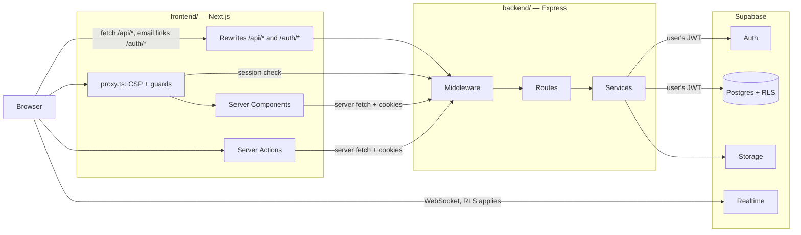

# Module: express-backend

Move all server-side logic from Next.js to an Express 5 API, in the same repository, as two separate projects: `frontend/` and `backend/`.

Depends on: the current `main` (commit `6073a15`). Shared rules: [SPEC.md](../SPEC.md).

**Status:** accepted by the person on 2026-11-07. This approves the new dependencies, environment variables and auth-plumbing changes it lists. Anything beyond them still falls under "Ask first" in `SPEC.md`.

## How Claude Code uses this document

1. Save this file as `spec/express-backend.md`. Do not use `docs/`: that folder is in `.gitignore`.
2. Add `express-backend` to the capability map in `SPEC.md`.
3. Work one task from [Tasks](#tasks) at a time, in order. Each task is one PR and must leave `main` deployable.
4. Follow [Migration rules](#migration-rules) on every task. The most important one: **move code, do not rewrite it.**
5. If the code contradicts this document, stop and report the difference. Do not improvise on auth, cookies or permissions.

## Summary of decisions

| # | Decision | Why |
|---|---|---|
| D1 | Supabase stays: Postgres, RLS, RPCs, Auth, Storage, Realtime. Express replaces the Next.js server layer, not the database. | 20 migrations and 14 pgTAP files hold the permission model. Replacing them adds risk and no product value. |
| D2 | Express calls Supabase **as the signed-in user** (per-request client, publishable key, session cookies), so RLS and `auth.uid()` keep working. The service-role client is used only where it is used today. | Every `security definer` RPC depends on `auth.uid()`. |
| D3 | Next.js stays as the UI: Server Components, Server Actions as thin adapters, `proxy.ts` for CSP and guards. It holds no business logic and makes no server-side Supabase calls. | The forms depend on `useActionState`, `redirect` and `revalidatePath`. Keeping actions as adapters avoids rewriting 30 action flows and their UI. |
| D4 | The browser only ever sees the frontend origin. Next.js rewrites `/api/*` and `/auth/*` to Express. | No CORS, host-only cookies keep working, and email links stay on the site's domain. |
| D5 | Two independent npm projects with their own `package.json` and lockfile. No workspaces and no third package. | This is the requested structure, and each project deploys on its own. |
| D6 | Shared code lives in `backend/src/contracts/` and is copied by a script to `frontend/lib/contracts/`. CI fails if the copy drifts. | Gives shared types and pure functions without a third project or imports across project folders. |
| D7 | Keep the existing `/api/*` paths and the `{ data, message? }` / `{ error, fieldErrors? }` response format. | The client components and test expectations keep working. |
| D8 | Express 5, TypeScript, ESM, zod 4, Vitest + Supertest. | Rejected promises reach the error handler natively; zod and Vitest are already in use. |
| D9 | Default hosting: a second Vercel project with Root Directory `backend`. The code stays portable to any Node host. | The frontend is already on Vercel. See the limits in [Deployment](#deployment). |
| D10 | Migrate incrementally. Next.js and Express can run side by side because they read the same Supabase cookies. | Each domain ships and rolls back on its own. |

## Current state

Facts from the repository at `6073a15`:

- One Next.js 16.4.5 project with 38 pages, 12 API route files, 2 auth callbacks and 30 Server Actions.
- About 8,100 lines in `lib/`, `app/api` and `app/auth`, and about 2,700 lines of Server Actions.
- The data layer is already framework-independent: `lib/<area>/service.ts` takes a `SupabaseClient` and returns `{ data } | { error }`. Only `lib/supabase/server.ts` and `lib/supabase/middleware.ts` import from `next/`.
- Business logic that is **not** in a service yet: inline queries in dashboard pages (`app/dashboard/client/page.tsx` runs about 12 queries in one `Promise.all`) and profile writes in `app/dashboard/actions.ts`.
- Realtime is used by 2 client components (`messaging-app-client.tsx`, `message-thread-client.tsx`) on `postgres_changes` for `messages`.
- Storage: one public `avatars` bucket.
- Service-role use: account deletion, admin deletion of a user's login, and the registration avatar.
- Tests: 60 Vitest files with about 658 test cases, plus 14 pgTAP files.
- The product brand in code is **WorkBridge**, the repository is **SiteMatch**. Do not rename anything in this module. Keep cookie and storage names such as `wb_recovery`.

## Target architecture



The only direct link from the browser to Supabase is the small set in [Browser Supabase client](#browser-supabase-client). Avatar images also load directly from their public Storage URL, as they do today.

## Repository layout

```text
/
├── CLAUDE.md                   # Short map; points to SPEC.md and this spec
├── SPEC.md, spec/, tasks/      # Unchanged location
├── supabase/                   # Unchanged location; belongs to neither project
├── package.json                # Tooling only: supabase CLI, concurrently, root scripts. NOT workspaces
├── scripts/
│   ├── sync-contracts.mjs      # Copies contracts + generated DB types to the frontend
│   └── check-boundaries.mjs    # Fails on forbidden imports
├── .github/workflows/ci.yml
│
├── backend/
│   ├── package.json, package-lock.json, tsconfig.json, vitest.config.ts
│   ├── .env.example
│   ├── dev/listen.ts           # Local runner only: imports the app and calls listen
│   ├── src/
│   │   ├── app.ts              # Imports express, createApp(), default export. Vercel entrypoint
│   │   ├── config/env.ts       # zod-validated environment, the only reader of process.env
│   │   ├── contracts/          # Shared: types, enums, schemas, pure functions (see below)
│   │   ├── types/supabase.ts   # Generated; never edit by hand
│   │   ├── lib/
│   │   │   ├── supabase/{request-client,admin,postgrest-filter}.ts
│   │   │   ├── http/{respond,errors,status-maps}.ts
│   │   │   └── logger.ts
│   │   ├── middleware/         # session, require-auth, require-internal, origin-guard,
│   │   │                       # validate, upload, not-found, error-handler
│   │   ├── routes/             # index.ts plus one router per domain
│   │   └── modules/            # Moved from lib/<area>: one folder per domain
│   │       ├── auth/ account/ admin/ messaging/ notifications/ profiles/
│   │       └── projects/ provider-services/ service-requests/ workrooms/ views/ navigation/
│   └── tests/{helpers,unit,routes}/
│
└── frontend/
    ├── package.json, package-lock.json, tsconfig.json, vitest.config.mts
    ├── next.config.ts, proxy.ts, postcss.config.mjs, eslint.config.mjs, .env.example
    ├── AGENTS.md               # Next.js agent rules; written by next dev
    ├── app/, components/, public/, theme/
    ├── lib/
    │   ├── api/{server,client,cookies,errors}.ts
    │   ├── contracts/          # GENERATED copy; never edit by hand
    │   ├── supabase/client.ts  # Realtime and idle sign-out only
    │   ├── navigation/menu-items.ts
    │   └── security/content-security-policy.ts
    └── tests/
```

Keep `supabase/` at the root. `supabase/config.toml` and its `./supabase/templates/...` paths keep working, and the existing `npx supabase ...` commands run from the root.

## Backend design

### Layers

| Layer | Allowed to | Not allowed to |
|---|---|---|
| `middleware/` | Read the request, attach `res.locals`, stop the request | Hold business rules |
| `routes/` | Validate input, call one service, map the result to HTTP | Call `.from()` or `.rpc()` |
| `modules/*/service.ts` | Query Supabase, return `Result<T>` | Import `express`; read `req` or `res` |
| `modules/*/schemas.ts` | zod schemas | Touch I/O |
| `contracts/` | Types, constants, pure functions; imports `zod` and relative files only | Touch I/O, `process.env`, Supabase, Node or browser APIs |

Keep the service signature: `fn(supabase, userId, ...args): Promise<Result<T>>`.

### Backend conventions

- `"type": "module"`, TypeScript `module: "NodeNext"`, relative imports ending in `.js`. Do not use a path alias at runtime: Vercel does not bundle the application.
- Express 5 route syntax: wildcards are named, and optional segments use braces. `req.body` is `undefined` until parsed, and `req.query` is read-only.
- No `try/catch` just to call `next(err)`. Express 5 forwards rejected promises.
- New files use tabs, as `SPEC.md` requires. Moved files keep their style.

### Application setup

```ts
// backend/src/app.ts
import express from "express";
import helmet from "helmet";
import { env } from "./config/env.js";
import { originGuard } from "./middleware/origin-guard.js";
import { sessionClient } from "./middleware/session.js";
import { notFound } from "./middleware/not-found.js";
import { errorHandler } from "./middleware/error-handler.js";
import { apiRouter, authCallbackRouter } from "./routes/index.js";

export function createApp() {
	const app = express();
	app.disable("x-powered-by");
	app.set("trust proxy", env.TRUST_PROXY_HOPS);
	app.use(helmet());
	app.get("/health", (_req, res) => { res.json({ ok: true }); });
	// Responses can carry session cookies, so no shared cache may ever store one.
	app.use((_req, res, next) => { res.setHeader("Cache-Control", "private, no-store"); next(); });
	app.use(originGuard);
	app.use(sessionClient);
	app.use("/auth", authCallbackRouter);
	app.use("/api", apiRouter);
	app.use(notFound);
	app.use(errorHandler);
	return app;
}

export default createApp();
```

Body parsers are mounted per route: `express.json({ limit: "64kb" })` matches today's Server Action cap. Multipart routes use `upload` instead.

### Per-request Supabase client

This adapter was compiled and run against `@supabase/ssr` 0.10.2, the installed range. Do not upgrade `@supabase/ssr` as part of this module.

```ts
// backend/src/lib/supabase/request-client.ts
import type { Request, Response } from "express";
import { createServerClient, parseCookieHeader, serializeCookieHeader } from "@supabase/ssr";
import { env } from "../../config/env.js";
import type { Database } from "../../types/supabase.js";

export function createRequestClient(req: Request, res: Response) {
	return createServerClient<Database>(env.SUPABASE_URL, env.SUPABASE_PUBLISHABLE_KEY, {
		cookies: {
			getAll() {
				return parseCookieHeader(req.headers.cookie ?? "").map(({ name, value }) => ({
					name,
					value: value ?? "",
				}));
			},
			setAll(cookiesToSet, headers) {
				if (res.headersSent) {
					return; // A handler must await auth work before it responds.
				}
				for (const { name, value, options } of cookiesToSet) {
					res.appendHeader("Set-Cookie", serializeCookieHeader(name, value, options));
				}
				for (const [key, value] of Object.entries(headers ?? {})) {
					res.setHeader(key, value);
				}
			},
		},
	});
}
```

`sessionClient` puts this on `res.locals.supabase`. Create one per request and never share one between requests.

`SUPABASE_URL` must be **exactly** the value of the frontend's `NEXT_PUBLIC_SUPABASE_URL`, because the cookie name comes from its host (`sb-<host-part>-auth-token`). Mixing `localhost` and `127.0.0.1` silently signs users out, and so does using a different URL in the browser.

### Middleware

| Middleware | Applies to | Behaviour |
|---|---|---|
| `originGuard` | Every `POST`, `PATCH`, `PUT`, `DELETE` | Allows a valid `x-internal-secret`, or an `Origin` listed in `FRONTEND_ORIGINS`. Otherwise `403 { error: "Invalid request origin." }`. Replaces the per-route checks, which cannot work here: behind a rewrite, `req.url` and `Host` show the backend. |
| `sessionClient` | All | Creates `res.locals.supabase`. No network call. |
| `requireAuth` | Signed-in routes | `supabase.auth.getUser()`; sets `res.locals.user`, or `401 { error: "Unauthorized." }`. Use `getUser`, as today, so behaviour stays the same. |
| `optionalAuth` | Public routes that personalise | Same, with `res.locals.user = null` for an anonymous visitor. |
| `requireInternal` | Auth form endpoints and everything marked **BFF** below | Timing-safe comparison of `x-internal-secret`. Otherwise `403`. |
| `validate(schema)` | Routes with input | zod `safeParse`. On failure, `400 { error: "Validation failed.", fieldErrors }`. |
| `upload(maxBytes)` | Multipart routes | `multer` with memory storage, a file size limit, one file field. Content checks stay in `validateAvatarFile` (magic bytes). |
| `errorHandler` | Last | Logs with a request id and returns `500 { error: "Something went wrong." }`. Never returns a stack or raw database message. |

Roles stay in the services and in RLS, exactly where they are now. Do not add a parallel role middleware.

### Client IP and rate limits

`getRequestIp` currently trusts the first `x-forwarded-for` value. A test through a local Next.js rewrite confirmed that a client-supplied value reaches the backend unchanged, so the header cannot be trusted by itself.

- Login, register, password-reset and resend endpoints are **BFF only** (`requireInternal`).
- The Server Action reads the IP from its own request headers and sends it as `x-client-ip`.
- Express uses `x-client-ip` only after `requireInternal` has passed. The rate-limit code otherwise moves unchanged, with the same scopes and limits.

### HTTP mapping

Today, each route handler maps error strings to status codes. Move those maps as they are, into `lib/http/status-maps.ts`, one per domain:

```ts
export const projectStatus: StatusMap = {
	"Only clients can manage project listings.": 403,
	"Project not found.": 404,
	"Complete your client profile before managing listings.": 409,
};
```

Errors not in a map return 400. **Error strings are part of the contract**: do not reword them, because the status maps, the UI and the tests depend on them. Services that already return a `status` (admin, avatar) keep it.

Response format, identical to today:

```jsonc
{ "data": {}, "message": "optional" }                  // 2xx
{ "error": "User-facing sentence", "fieldErrors": {} } // 4xx/5xx
```

## Auth and sessions

### Rules

1. Session cookies are created and refreshed by Express and stored by the browser on the **frontend origin**.
2. `@supabase/ssr` cookies stay readable by JavaScript, because the browser client needs the token for Realtime.
3. `proxy.ts` is the one place that persists a refreshed session during page navigation. Server Components cannot write cookies.
4. Keep the Supabase refresh-token settings as they are (rotation on, 10-second reuse interval).

### Flows

**Page navigation**

1. `proxy.ts` sets the nonce and CSP.
2. If the path is guarded or an `sb-*-auth-token` cookie exists, it calls `GET {BACKEND_URL}/api/session` with the cookies.
3. It copies any `Set-Cookie` to the browser response **and** rewrites the forwarded request's `cookie` header, so Server Components on this same request use the new token.
4. It applies the role guards from today's `proxy.ts`, unchanged, using `{ user, role, enabled }` from the response.
5. If the backend is unreachable on a guarded path, it returns a 503 page. It must not redirect to `/login` or clear cookies, since an outage is not a sign-out.

`GET /api/session` returns `200 { data: null }` for an anonymous visitor. For a disabled account, it signs out locally and returns `{ data: null }`, as today's proxy does.

**Server Component read**

`api("/api/views/...")` forwards cookies and sends the internal secret. A `Set-Cookie` here cannot be stored. Step 3 above is what prevents that from mattering, and the reuse interval covers the remaining race.

**Server Action write**

`api()` forwards cookies, and copies `Set-Cookie` into `cookies()`. The action then calls `revalidatePath` and `redirect`, as today.

**Login**

Form → `loginAction` → `POST /api/auth/login` (BFF) → Express signs in, checks the rate limit, provisions the profile and checks that the account is enabled. It returns `{ data: { role } }` plus cookies → the action computes the redirect from `next` or `getDashboardPath(role)`.

**Registration avatar**

The action forwards the same `FormData`. The 48 KB limit stays, since the Server Action cap still applies.

**Email confirmation and password recovery**

Emails keep linking to `{SITE_URL}/auth/confirm` and `/auth/recovery`. The rewrite sends them to Express, which runs the two existing handlers. Keep every check, the `url.hash = "#"` step, `Referrer-Policy: no-referrer` and the `wb_recovery` cookie with `Path=/reset-password`. No Supabase redirect URL changes are needed.

**Reset password**

The `wb_recovery` cookie has `Path=/reset-password`, so the browser only sends it to that page and its Server Action. The BFF forwards the cookie explicitly. Express compares it with the user id, updates the password, clears the marker and signs out globally.

**Account deletion**

`POST /api/account/delete` (BFF). `deleteOwnAccount` moves unchanged, with its lazy admin client, and Express clears the session cookies.

### Browser Supabase client

`frontend/lib/supabase/client.ts` stays, limited to:

- Realtime subscriptions in the two messaging components (`authenticateSupabaseRealtime`).
- `auth.getSession()` and `auth.signOut()` in `idle-session-timeout.tsx`.

`check-boundaries.mjs` enforces this list. CSP `connect-src` keeps the Supabase origins for it. Do not replace Realtime with Socket.IO: RLS already protects these subscriptions, and serverless hosting makes long-lived sockets on Express the wrong fit.

### Service-role client

Lives only in `backend/src/lib/supabase/admin.ts`. Keep it lazy, so a missing key fails only the feature that needs it, as today. Its only callers stay the registration avatar, `deleteOwnAccount` and the admin user deletion.

## Frontend design

### Rewrites

Use `fallback`, not a plain array. An array or `afterFiles` rewrite runs **before** dynamic routes, so `/api/:path*` would take over `app/api/projects/[id]` before that route has moved. With `fallback`, a route moves when its Next.js handler is deleted.

```ts
// frontend/next.config.ts (added to the existing config)
async rewrites() {
	const backend = process.env.BACKEND_URL;
	if (!backend) throw new Error("Set BACKEND_URL.");
	return {
		beforeFiles: [],
		afterFiles: [],
		fallback: [
			{ source: "/api/:path*", destination: `${backend}/api/:path*` },
			{ source: "/auth/:path*", destination: `${backend}/auth/:path*` },
		],
	};
},
```

`next.config.ts` runs at build time, so `BACKEND_URL` must be set for the build.

Extend the `proxy.ts` matcher to skip `auth/` as well as `api/`. These are redirects and need neither CSP nor a session check.

### Server API client

```ts
// frontend/lib/api/server.ts
import "server-only";
import { cookies, headers } from "next/headers";
import { applySetCookies } from "./cookies";

export type ApiResult<T> =
	| { ok: true; status: number; data: T; message?: string }
	| { ok: false; status: number; error: string; fieldErrors?: Record<string, string[] | undefined> };

export async function api<T>(path: string, init: RequestInit = {}): Promise<ApiResult<T>> {
	const cookieStore = await cookies();
	const requestHeaders = await headers();
	const outgoing = new Headers(init.headers);
	outgoing.set("cookie", cookieStore.toString());
	outgoing.set("x-internal-secret", process.env.INTERNAL_API_SECRET!);
	outgoing.set("x-client-ip", requestHeaders.get("x-forwarded-for")?.split(",")[0]?.trim() ?? "unknown");

	let response: Response;
	try {
		response = await fetch(`${process.env.BACKEND_URL}${path}`, { ...init, headers: outgoing, cache: "no-store" });
	} catch {
		return { ok: false, status: 503, error: "The service is temporarily unavailable. Please try again." };
	}

	await applySetCookies(response.headers.getSetCookie()); // No-op in a Server Component.
	const body = await response.json().catch(() => null);
	return response.ok
		? { ok: true, status: response.status, data: body?.data as T, message: body?.message }
		: { ok: false, status: response.status, error: body?.error ?? "Request failed.", fieldErrors: body?.fieldErrors };
}
```

`applySetCookies` parses each `Set-Cookie` line and calls `cookies().set`. It must decode the value once, because Next.js encodes it again, and must catch the error thrown in a Server Component. Test a chunked `sb-*` cookie round trip. A local test produced 4 chunks and 11 KB of `Cookie` header, so also confirm this size is accepted in staging.

`frontend/lib/api/client.ts` is a small `fetch` wrapper for browser calls to `/api/*`, which the components already do today.

### Server Action example

Actions keep their exported name, signature and return state, so the components do not change. They stop validating and querying.

```ts
// Before: getUser + zod + service call. After:
export async function applyToProjectAction(projectId: string, _prev: JobApplicationActionState, formData: FormData) {
	const fields = buildFields(formData);
	const result = await api<{ id: string }>(`/api/projects/${projectId}`, {
		method: "POST",
		headers: { "content-type": "application/json" },
		body: JSON.stringify(toApplicationInput(fields)),
	});

	if (!result.ok) {
		return { formError: result.error, fieldErrors: result.fieldErrors ?? {}, fields };
	}

	revalidatePath(`/jobs/${projectId}`);
	redirect(/* same target as today */);
}
```

Move the input parsing that `FormData` needs (such as `getNumberValue`) to the action. Validation itself moves to Express, so there is exactly one validator. The exact redirect and revalidation lists stay in the action, copied from today's code.

### Cache revalidation

Express cannot call `revalidatePath`. Two browser-initiated routes do this today:

| Route | After the move |
|---|---|
| `POST`/`DELETE /api/profile/avatar` | The browser uploads through the rewrite, because of the 2 MB size. On success, it calls a new `refreshAfterAvatarChangeAction` that runs `revalidatePath("/", "layout")`. |
| `POST /api/admin/moderation` | `moderation-dialog.tsx` calls a new `moderateAction`, which calls the API (BFF) and runs the same revalidation, including on a 503 result. Drop the `/find-work` revalidation: no such route exists. |

### Shared contracts

`backend/src/contracts/` is the source of truth; `npm run contracts:sync` copies it, with `backend/src/types/supabase.ts`, to `frontend/lib/contracts/`.

| Goes in contracts | Stays out |
|---|---|
| Response types: `ConversationListItem`, `ConversationDetail`, `HeaderUser`, list and detail types | `service.ts` files |
| Enums and status helpers: `lib/auth/roles.ts`, `lib/projects/application-status.ts` | Anything reading `process.env` |
| Forms' options and schemas: `lib/auth/client-profile.ts`, `lib/auth/provider-profile.ts`, `lib/admin/schemas.ts` | `lib/admin/ui.ts`, `lib/navigation/menu-items.ts` (frontend only) |
| Pure helpers: `lib/auth/return-url.ts`, `lib/auth/email-verification.ts`, `lib/auth/place-name.ts`, `lib/auth/password.ts`, `lib/provider-services/formatters.ts` | `lib/profiles/resize-avatar.ts` (browser only) |
| Avatar constants, `setAvatarFormField`, and `getAvatarUrl(baseUrl, path)` with the base URL as a parameter | Other avatar upload and storage code (backend) |
| Query-string helpers that pages use: `lib/provider-services/find-talent-query.ts`, `lib/projects/jobs-pagination.ts`, status filters from `lib/provider-service-requests/schemas.ts` and `lib/service-workrooms/schemas.ts`, and `lib/profiles/public-profile-view.ts` | Their server-only parts, if a file mixes both: split it |

The moved helpers must not change behaviour. Client components now import types from `@/lib/contracts/...`; several import from `@/lib/messaging/service` today, which must not exist on the frontend.

## File mapping

| Today | Target |
|---|---|
| `app/`, `components/`, `theme/`, `public/`, `proxy.ts`, `next.config.ts`, CSS and ESLint config | `frontend/` |
| `lib/<area>/service.ts`, `lib/projects/queries.ts` | `backend/src/modules/<area>/` (`provider-service-requests` → `service-requests`, `service-workrooms` → `workrooms`) |
| `lib/<area>/schemas.ts` | `backend/src/modules/<area>/schemas.ts`, or `contracts/` if the frontend needs it |
| `lib/account/delete-account.ts`, `lib/admin/service.ts`, `lib/auth/{provision,rate-limit,own-contact,account-access,site-url,recovery-cookie}.ts` | `backend/src/modules/{account,admin,auth}/` |
| `lib/navigation/header-state.ts` | `backend/src/modules/navigation/`; its types go to contracts |
| `lib/profiles/{avatar,public-profile}.ts` | `backend/src/modules/profiles/` |
| `lib/supabase/{admin,postgrest-filter,env}.ts`, new `request-client.ts` | `backend/src/lib/supabase/`, `config/env.ts` |
| `lib/supabase/{server,middleware}.ts` | Deleted at the end |
| `lib/supabase/client.ts`, `lib/security/*`, `lib/navigation/menu-items.ts`, `lib/legal.ts`, `lib/admin/ui.ts` | `frontend/lib/` |
| `app/api/**/route.ts`, `app/auth/**/route.ts` | `backend/src/routes/*.ts` |
| Inline queries in `app/**/page.tsx` | `backend/src/modules/views/` |
| Validation and profile writes in `app/dashboard/actions.ts`, auth logic in `app/(auth)/*actions.ts` | `backend/src/modules/{profiles,auth}/service.ts` |
| `types/supabase.ts` | `backend/src/types/supabase.ts`, copied to contracts |
| `tests/` | Split; see [Testing](#testing) |
| `scripts/smoke-local.mjs` | `backend/scripts/`; keep the local-only check |
| `scripts/access-matrix.sql`, `find-test-data.sql` | Stay in root `scripts/` |

Update the Supabase types command to write to `backend/src/types/supabase.ts`, then run the sync.

`getAuthSiteOrigin` must change when it moves: read only `SITE_URL` and remove the `VERCEL_*` fallback. On the backend's Vercel project those variables name the **API** host, which would put the wrong domain in emails.

## API catalog

**Auth** column: `public`, `user` (`requireAuth`), `optional` (`optionalAuth`), `BFF` (`requireInternal` and, where needed, `requireAuth`). Paths marked "existing" keep their method, path and status codes.

### Session and auth

| Method and path | Auth | Replaces |
|---|---|---|
| `GET /api/session` | optional, BFF | Guard logic in `proxy.ts` |
| `POST /api/session/bootstrap` | BFF | `getUser` + `ensureUserProfile` at the top of pages. Returns role; on failure, signs out and returns 401 |
| `GET /api/me/header` | optional, BFF | `getCurrentHeaderState` |
| `POST /api/auth/register` | BFF, multipart | `registerAction` |
| `POST /api/auth/login` | BFF | `loginAction` |
| `POST /api/auth/logout` | BFF | `logoutAction` |
| `POST /api/auth/password-reset/request` | BFF | `requestPasswordResetAction` |
| `POST /api/auth/password-reset/confirm` | BFF | `resetPasswordAction` |
| `GET /api/auth/recovery-status` | BFF | Check in `app/reset-password/page.tsx` |
| `POST /api/auth/verification/resend` | BFF | `resendConfirmationAction` |
| `GET /auth/confirm` | public | `app/auth/confirm/route.ts` |
| `GET /auth/recovery` | public | `app/auth/recovery/route.ts` |

### Profiles and account

| Method and path | Auth | Replaces |
|---|---|---|
| `PATCH /api/profile/client` | user | `updateClientProfileAction` |
| `PATCH /api/profile/provider` | user | `updateProviderProfileAction` |
| `PATCH /api/profile/admin` | user | `updateAdminProfileAction` |
| `POST /api/profile/avatar`, `DELETE` | user, multipart for POST | existing |
| `GET /api/profiles/:id` | optional | `getPublicProfile` |
| `POST /api/account/delete` | BFF | `deleteAccountAction` |

### Projects and applications

| Method and path | Auth | Replaces |
|---|---|---|
| `GET`, `POST /api/projects` | user | existing |
| `GET /api/projects/meta` | public | existing |
| `GET /api/projects/mine` | user | existing |
| `GET`, `PATCH`, `POST /api/projects/:id` | user | existing. POST also replaces `applyToProjectAction`. PATCH also replaces `updateClientProjectAction` |
| `GET /api/projects/:id/applications` | user | existing |
| `GET /api/projects/:id/my-application` | user | `getProviderApplicationForProject` |
| `POST /api/projects/:id/cancel` | user | `cancelClientProjectAction` |
| `GET /api/public/projects`, `GET /api/public/projects/:id` | optional | `getPublicPublishedProjects`, `getPublicPublishedProjectById` |
| `GET`, `PATCH /api/applications/:id` | user | existing. PATCH also replaces `updateClientApplicationStatusAction` |
| `POST /api/applications/:id/viewed` | user | `reviewApplicationAction` |
| `POST /api/applications/:id/withdraw` | user | `withdrawApplicationAction`, `withdrawProviderApplicationFromJobAction` |
| `POST /api/applications/:id/conversation` | user | `openApplicationConversationAction`, `openProviderApplicationConversationAction` |

`POST /api/projects` also replaces `createClientProjectAction`.

### Services, requests and workrooms

| Method and path | Auth | Replaces |
|---|---|---|
| `GET /api/public/services`, `GET /api/public/services/:id` | optional | Find Talent and landing page reads |
| `GET /api/services/form-meta` | user | Inline `service_types`, `project_categories` queries |
| `POST /api/services` | user | `createProviderServiceListingAction` |
| `GET`, `PATCH`, `DELETE /api/services/:id` | user | `getProviderServiceListingForProvider`, `updateProviderServiceListingAction`, `deleteProviderServiceListingAction` |
| `POST /api/services/:id/requests` | user | `requestProviderServiceAction` |
| `GET /api/services/:id/active-request` | user | `getActiveServiceRequest` |
| `GET /api/service-requests/:id` | user | `getServiceRequestDetailForParticipant` |
| `POST /api/service-requests/:id/accept` | user | `acceptServiceRequestAction` |
| `POST /api/service-requests/:id/reject` | user | `rejectServiceRequestAction` |
| `POST /api/service-requests/:id/cancel` | user | `cancelServiceRequestAction` |
| `GET /api/workrooms/:id` | user | `getWorkroomDetailForParticipant` |
| `POST /api/workrooms/:id/complete` | user | `completeWorkroomAction` |

### Messaging, notifications and admin

| Method and path | Auth | Replaces |
|---|---|---|
| `GET /api/conversations` | user | existing |
| `GET`, `PATCH /api/conversations/:id` | user | existing |
| `POST /api/conversations/:id/messages` | user | existing |
| `GET /api/notifications` | user | `getNotifications` |
| `POST /api/notifications/:id/read` | user | `openNotificationAction` |
| `POST /api/notifications/read-all` | user | `markAllNotificationsReadAction` |
| `GET /api/admin/:resource` | user | existing (role checked in service) |
| `POST /api/admin/moderation` | BFF | existing, called through `moderateAction` |

### Page views

A dashboard page with inline queries gets **one** endpoint that returns everything it renders. This keeps the parallel queries together, avoids many calls per page, and moves the query code to the backend intact. Pure formatting stays in the page.

Every view is `GET`, `user`, BFF, under `/api/views/`.

| Page | View endpoint |
|---|---|
| `dashboard/client/page.tsx` | `client-overview` |
| `dashboard/client/profile/page.tsx` | `client-profile` |
| `dashboard/client/projects/page.tsx` | `client-projects` |
| `dashboard/client/service-requests/page.tsx` | `client-service-requests` |
| `dashboard/client/workrooms/page.tsx` | `client-workrooms` |
| `dashboard/provider/page.tsx` | `provider-overview` |
| `dashboard/provider/profile/page.tsx` | `provider-profile` |
| `dashboard/provider/applications/page.tsx` | `provider-applications` |
| `dashboard/provider/service-requests/page.tsx` | `provider-service-requests` |
| `dashboard/provider/services/page.tsx` | `provider-services` |
| `dashboard/provider/workrooms/page.tsx` | `provider-workrooms` |
| `dashboard/messages/page.tsx` | `messages` |
| `dashboard/notifications/page.tsx` | `notifications` |
| `dashboard/service-requests/[id]/page.tsx` | `service-requests/:id` |
| `dashboard/workrooms/[id]/page.tsx` | `workrooms/:id` |
| `oglasi/page.tsx` | `client-briefs` |
| `oglasi/[id]/page.tsx` | `client-briefs/:id` |
| `oglasi/[id]/edit/page.tsx` | `client-briefs/:id/edit` |
| `oglasi/novi/page.tsx` | `client-briefs/new` |
| `jobs/page.tsx` | `jobs` (optional auth) |
| `jobs/[id]/page.tsx` | `jobs/:id` (optional auth) |
| `find-talent/[id]/page.tsx` | `find-talent/:id` (optional auth) |
| `profiles/[id]/page.tsx` | `profiles/:id` (optional auth) |

These pages use other endpoints or none:

| Page | Uses |
|---|---|
| `app/page.tsx`, `find-talent/page.tsx` | `GET /api/public/services` |
| `dashboard/page.tsx` | `POST /api/session/bootstrap`, then redirect |
| `dashboard/admin/page.tsx`, `dashboard/admin/[resource]/page.tsx` | `GET /api/admin/:resource` |
| `dashboard/provider/services/post/page.tsx`, `dashboard/provider/services/[id]/page.tsx` | `form-meta`, `GET /api/services/:id` |
| `dashboard/messages/[id]/page.tsx`, `login`, `register`, `forgot-password`, `verify-email`, `privacy`, `terms` | No server data of their own |
| `reset-password/page.tsx` | `GET /api/auth/recovery-status` |

Before writing a view, read the page and return only what it renders. Personal fields must never appear in `public` or `optional` responses for anyone except the owner. RLS and the profile column grants remain the backstop.

## Security invariants

These must hold after every task, and each needs a test.

| Invariant | Enforced by |
|---|---|
| Service-role key never reaches the frontend project or the browser | Only in backend env; `check-boundaries.mjs` |
| Normal requests use the user's JWT, so RLS applies | `createRequestClient`; admin client limited to its three callers |
| Permissions stay in RLS and RPCs | pgTAP suite unchanged and green |
| Forged origins are rejected on writes | `originGuard` |
| IP rate limits cannot be bypassed by a forged header | BFF-only auth endpoints, `x-client-ip` trusted only after the secret check |
| Responses carrying cookies are never cached | Global `Cache-Control: private, no-store`. Supabase warns that a cached `Set-Cookie` can sign one user in as another |
| Email links never derive from request headers | `SITE_URL` only |
| Redirect targets from input are safe | `getSafeReturnPath`, `getVerificationReturnPath` unchanged |
| Internal secret stays server-side | No `NEXT_PUBLIC_` prefix; never sent to the browser; accepts a comma-separated list for rotation |
| Errors do not leak internals | `errorHandler`; `RPC` messages stay user-facing sentences |

The backend URL is publicly reachable. This is acceptable: it holds no authority beyond the caller's own session, and session cookies are host-only on the frontend domain. Do not add CORS.

## Environment variables

| Variable | Backend | Frontend | Notes |
|---|---|---|---|
| `SUPABASE_URL` | ✓ | | Same value as `NEXT_PUBLIC_SUPABASE_URL` |
| `SUPABASE_PUBLISHABLE_KEY` | ✓ | | |
| `SUPABASE_SERVICE_ROLE_KEY` | ✓ | | **Remove from frontend** at cutover |
| `AUTH_RATE_LIMIT_SECRET` | ✓ | | Same value as today; remove from frontend at cutover |
| `INTERNAL_API_SECRET` | ✓ | ✓ | New. At least 32 random bytes |
| `SITE_URL` | ✓ | | Public frontend origin, used in emails |
| `FRONTEND_ORIGINS` | ✓ | | Comma-separated, for `originGuard` |
| `TRUST_PROXY_HOPS` | ✓ | | Number; default `1`; used for logs |
| `PORT` | ✓ | | Local only; default `4000` |
| `NEXT_PUBLIC_SUPABASE_URL` | | ✓ | Realtime, avatar URLs, CSP |
| `NEXT_PUBLIC_SUPABASE_PUBLISHABLE_KEY` | | ✓ | Realtime |
| `NEXT_PUBLIC_SITE_URL` | | ✓ | Metadata |
| `BACKEND_URL` | | ✓ | Server-side and build time. Local `http://127.0.0.1:4000` |

## New dependencies

Approved by accepting this spec. Install the latest compatible release and commit the lockfile.

| Project | Runtime | Dev |
|---|---|---|
| `backend` | `express@5`, `helmet`, `multer`, `zod@4`, `@supabase/ssr@^0.10.2`, `@supabase/supabase-js@^2.104.0` | `typescript`, `tsx`, `vitest`, `@vitest/coverage-v8`, `supertest`, `@types/express`, `@types/multer`, `@types/supertest`, `@types/node`, `eslint@^9`, `@eslint/js@^9`, `typescript-eslint` (approved by the person, 2026-11-07) |
| `frontend` | No additions | No additions. `@supabase/ssr` stays only for `createBrowserClient`; `zod` stays for contracts |
| Root | None | `supabase`, `concurrently` |

Use `console` for logging, matching the codebase. A logging library can come later.

## Commands

```bash
# Root
npm install && npm --prefix backend install && npm --prefix frontend install
npm run dev              # concurrently: backend :4000, frontend :3000
npm run contracts:sync
npm run contracts:check  # fails on drift
npm run check            # lint, typecheck, tests, boundaries in both projects
npx supabase start | db reset | test db

# backend
npm run dev              # tsx watch dev/listen.ts
npm run build            # tsc --noEmit
npm test
npm run smoke

# frontend: unchanged
npm run dev | build | lint | typecheck | test
```

## Testing

Move existing tests. Keep the assertions; change only imports and how a handler is invoked. A test may be deleted only if its subject no longer exists, and the PR must say so.

| Today | Target |
|---|---|
| `tests/helpers/supabase-stub.ts`, `form-data.ts` | `backend/tests/helpers/` |
| `tests/unit/*` for services, schemas, rate limit, provision, avatar | `backend/tests/unit/` |
| `tests/routes/*` calling exported `GET`/`POST` | `backend/tests/routes/`, using Supertest on `createApp()`, mocking the request client |
| `tests/routes/auth-*.test.ts` | Same; assert redirects, headers, cookies |
| Action tests (`*-actions.test.ts`) | Split: logic goes to backend route tests; `frontend/tests/` keeps mapping, redirect and revalidation, with `api()` mocked |
| `proxy.test.ts`, `content-security-policy.test.ts`, `next-config-headers.test.ts`, UI helper tests | `frontend/tests/` |
| `migrations-define-rpcs.test.ts`, `profile-columns.test.ts` | `backend/tests/unit/`; update their scan paths to `backend/src` and `../supabase/migrations`. Confirm they still find the same RPCs, so they do not pass by scanning nothing |
| `supabase/tests/database/*` | Unchanged |

New tests required:

- `request-client`: reads and writes chunked cookies; respects `headersSent`.
- `originGuard`, `requireInternal`: allow and deny.
- Rate-limit IP source: a forged `x-forwarded-for` has no effect.
- `applySetCookies`: round trip, and no throw in a Server Component.
- `proxy`: copies refreshed cookies to both request and response; 503 on outage for guarded paths.
- `check-boundaries.mjs`: fails on a planted violation.
- Integration (local stack): extend `npm run smoke` to go browser-side through `localhost:3000`: register → confirm → log in → post brief → apply → accept → message → complete, plus the service flow and password reset.

## CI

`.github/workflows/ci.yml` keeps the name "CI" and needs no new secrets:

- `backend`: `npm ci`, lint, typecheck, test, build (working directory `backend`).
- `frontend`: `npm ci`, lint, typecheck, test, build, with placeholders including `BACKEND_URL=http://localhost:4000` (working directory `frontend`).
- `contracts`: `node scripts/sync-contracts.mjs --check`; `node scripts/check-boundaries.mjs`.
- `database`: unchanged.

Branch protection names change, so a repository admin must update required checks after task EB0.

### `check-boundaries.mjs` rules

- `frontend/` imports `@supabase/*` only in `lib/supabase/client.ts`.
- `frontend/` never contains `createServerClient`, `SUPABASE_SERVICE_ROLE_KEY`, `.rpc(` or `.from("` outside that file. (After EB9. Before that, a shrinking allowlist in the script tracks unmigrated files.)
- No file in `frontend/` imports from `../backend`, and vice versa.
- `backend/src/modules/**` does not import `express`.
- `backend/src/contracts/**` imports only `zod` and relative paths.

## Deployment

Production steps are done by a person, as `SPEC.md` requires. Claude Code does not deploy, push, or run commands against the remote Supabase project unless the person explicitly asks.

**Vercel, two projects from one repository:**

| Project | Root Directory | Notes |
|---|---|---|
| Existing | `frontend` | Change in settings at EB0, and add `BACKEND_URL` and `INTERNAL_API_SECRET` at EB1 |
| New API | `backend` | Vercel detects Express from `src/app.ts`, which must import `express` and default-export the app |

Limits and notes that apply to this design:

- Request and response bodies are limited to 4.5 MB; the 2 MB avatar fits. On Vercel, Express runs as one function, and `express.static` does not serve files.
- Keep the backend's function region close to the Supabase region. Each page render now adds a hop, and the region must be checked by a person.
- Automatic skipping of unaffected projects requires workspaces, which this design does not use. Use an Ignored Build Step per project, for example `git diff --quiet HEAD^ HEAD -- . ../supabase`, so that a change in one project does not rebuild the other.
- Preview deployments: all frontend previews point to one staging backend through `BACKEND_URL`. Add both the preview pattern and the production origin to `FRONTEND_ORIGINS` per environment. Auth emails link to the backend's `SITE_URL`, so test them on staging, not on a preview.
- Vercel's documentation does not spell out how an external rewrite treats `Set-Cookie`, `Origin` and `x-forwarded-for`. A local Next.js test passed, but EB1 must prove it on Vercel before anything else moves.

**Cutover:** nothing changes for users at a single moment, since each task moves one domain behind the same paths. Remove `SUPABASE_SERVICE_ROLE_KEY` and `AUTH_RATE_LIMIT_SECRET` from the frontend project only after EB9 is live.

**Rollback:** revert the PR for that task, and the Next.js handler or action returns. Express and Next.js use the same cookies, and no task in this module changes the database.

## Migration rules

1. **Move, do not rewrite.** Same queries, messages, status codes and ordering. Improvements go in separate PRs after this module.
2. **No schema changes.** No new migrations, RLS or RPC changes. If a task seems to need one, stop and ask.
3. **Same behaviour for users.** Same pages, copy, redirects and notices (`?serviceStatus=`, etc.).
4. **Keep components unchanged where possible.** Change imports only, unless the task says otherwise.
5. **One domain per PR.** After each: lint, typecheck, tests in both projects, `npx supabase test db`, build, contracts check.
6. **Delete as you go.** When a route, action body or service moves, remove the old code in the same PR, and shrink the boundary allowlist.
7. **No duplicate logic.** Never keep a service on both sides.
8. Read the matching guide in `frontend/node_modules/next/dist/docs/` before using a Next.js API.
9. Commit and push only when the person asks.

## Tasks

### EB0: Split the repository (mechanical)

- `git mv` the Next.js project into `frontend/`. Leave `supabase/` and `spec/` at the root; add the root `package.json`.
- Update the "Branching" row of `SPEC.md` to: one branch per task from `main`, PR into `main`.
- Update CI paths and the types command. No code behaviour changes.
- **Done when:** all existing tests, lint, typecheck, build and pgTAP pass from the new paths, and `npm run dev` runs the app as before. Person changes the Vercel Root Directory to `frontend`.

### EB1: Backend skeleton, and prove the plumbing

- Create `backend/`: env, `createApp`, all middleware, `dev/listen.ts`, `/health`, CI job, `sync-contracts`, `check-boundaries` (allowlist mode).
- Add temporary `GET /api/_diag` returning the received `origin`, `x-forwarded-host`, and cookie count, plus a `POST` that sets 2 test cookies. Add the frontend's `fallback` rewrites.
- **Done when:** on a Vercel staging deployment through the frontend domain: multiple `Set-Cookie` headers arrive; a large `Cookie` header passes; `Origin` matches the browser; a forged `x-forwarded-for` is overwritten or ignored; `Cache-Control` is unchanged. Record the results in this spec, then remove `_diag`. **If this fails, stop and report.**

### EB2: API client and session

- `frontend/lib/api/*`, `GET /api/session`, `POST /api/session/bootstrap`, `GET /api/me/header`; move `lib/auth/*` and `lib/navigation/header-state.ts`.
- Rewrite `proxy.ts` guards on `/api/session`. Keep CSP and guard rules. Move the proxy test cases.
- **Done when:** role guards behave as today; an expired access token refreshes once and the page renders signed-in; cookies are rotated in the browser; a stopped backend gives 503 on `/dashboard/*`.

**EB2 notes (2026-11-07).**

- **Temporary copies** (person's decision): the session endpoints need code that unmigrated frontend callers still use. The backend owns it; the frontend keeps a marked copy until its last caller moves. `TEMPORARY_COPIES` in `scripts/check-boundaries.mjs` lists each one and fails once a copy is gone, so the list must be emptied by EB9: `account-access.ts` (EB3); `provision.ts`, `findUploadedAvatarPath`, `getUnreadConversationCount`, `getUnreadNotificationCount` (EB8); the test helpers (EB9).
- Pure helpers from `lib/auth/` (roles, return-url, email-verification, place-name, password, client-profile, provider-profile, profile-completion) and the header and session types are in `contracts/`. Contracts may import the generated database types; the sync rewrites that import to the frontend copy.
- `GET /api/session` returns `{ user: { id }, role }`, or `null` for a signed-out or disabled visitor; `enabled` is not a separate field, because a disabled account is always `null`.
- `frontend/lib/api/client.ts` and `errors.ts` are not created yet; they come with their first caller (EB4).
- Local run against the local stack: role guards as before; an expired access token gives exactly one `token_refreshed` in the Auth log, the page renders signed in, the browser gets the rotated cookies, and they work on the next request; with the backend stopped, `/dashboard/*` and `/oglasi/novi` return 503 with no redirect and no `Set-Cookie`, and public pages still render.

### EB3: Auth flows

- Register, login, logout, password reset, resend, `/auth/confirm`, `/auth/recovery`; delete the old callbacks once rewrites serve them.
- **Done when:** the full flows work against Mailpit, including registration with an avatar, and the rate limit blocks by real IP. Sign-off from the person, since this is an auth change.

### EB4: Existing API routes

- Move the remaining `app/api/**` handlers (conversations, projects, applications, avatar, admin). Add `moderateAction` and `refreshAfterAvatarChangeAction`.
- **Done when:** `frontend/app/api` is gone; `tests/routes/*` pass on Supertest; messaging works with Realtime in two browsers.

### EB5: Public reads

- `/api/public/*`, `meta`, `/api/profiles/:id`; views `jobs`, `jobs/:id`, `find-talent/:id`, `profiles/:id`; landing and Find Talent pages.
- **Done when:** signed-out and signed-in rendering match; filters and pagination work; responses have no private fields.

### EB6: Hiring writes

- Project and application actions (`app/oglasi/actions.ts`, `app/jobs/actions.ts`, `withdrawApplicationAction`); views `client-briefs*`.
- **Done when:** post → apply → view → accept → reject → withdraw → cancel works, with the same notices and redirects.

### EB7: Service flow and workrooms

- Provider service, service-request, workroom actions and their detail views, form metadata pages.
- **Done when:** publish → request → accept → workroom → complete works for both flows, and notifications are created.

### EB8: Dashboards, profiles, notifications, account

- All remaining views; `modules/views`; profile actions; notification actions; account deletion.
- **Done when:** every dashboard page renders as before for client, provider and admin. Account deletion works with its failure paths tested.

### EB9: Cleanup and lock

- Delete `lib/supabase/{server,middleware,admin}.ts` from the frontend and any unused dependency. Remove the boundary allowlist. Update `SPEC.md` (stack, structure, commands, conventions) and `supabase/README.md`. Add `CLAUDE.md`.
- Person removes the frontend's service-role and rate-limit secrets.
- **Done when:** `check-boundaries` passes with no allowlist; CI is green; the extended smoke test passes through the frontend; a staging pass covers both hire flows, reset, deletion and moderation.

### Root `CLAUDE.md`, added at EB9

```md
# WorkBridge (repo: SiteMatch)
Two projects, one repo. `frontend/` is Next.js UI; `backend/` is the Express API; `supabase/` is the database.
Read SPEC.md first, then spec/<module>.md for the task at hand.
- Database access only in backend/src/modules/*/service.ts. The frontend calls lib/api.
- New endpoint: schema → service (+ test) → route (+ Supertest) → contracts:sync → frontend.
- Edit shared code in backend/src/contracts, then run npm run contracts:sync. Never edit frontend/lib/contracts.
- Permissions live in RLS and RPCs (supabase/). Schema changes only by a new migration, with pgTAP tests.
- Before a commit: npm run check && npx supabase test db.
- Before using a Next.js API: read frontend/node_modules/next/dist/docs/.
```

## Risks

| Risk | Impact | Mitigation |
|---|---|---|
| Vercel rewrite changes cookies or headers | High | EB1 tests this first; if it fails, the fallback is a shared parent domain (`api.` subdomain), which needs a separate design for cookies and CORS |
| Token rotated in a Server Component render is lost | Medium | `proxy.ts` refreshes first and forwards cookies; the reuse interval covers the race; test in EB2 |
| Added latency per page | Medium | Same region; one view per page; measure in EB5 before moving dashboards |
| Cookie-name mismatch signs everyone out | High | Same Supabase URL in both projects; checked in EB2 |
| Wrong domain in auth emails | High | `SITE_URL` only, no `VERCEL_*` fallback; test asserts the link origin |
| Scan-based tests pass by finding nothing | Medium | Assert a minimum count of RPCs and files after the path change |
| Moved client component pulls server code | Medium | Boundary check, plus frontend contains no services |
| Cold starts on the API function | Low | Vercel fluid compute; move to a long-running host if measurements require |
| Scope creep during the move | Medium | Migration rule 1; put findings in `tasks/todo.md` |

## Known repository drift

Handle these when the relevant task touches them, or report them. Do not fix them silently.

- `SPEC.md` says Next.js 16.2.4; `package.json` has 16.4.5.
- `SPEC.md` still says every task goes on one branch, `feat/daddy-is-here`. That branch is fully merged and stale; the repository uses one branch per task and PRs (latest merge: #54). EB0 fixes the "Branching" row; see [Decisions](#decisions-confirmed-by-the-person-2026-11-07).
- Stale remote branches: `dev` is 111 commits behind `main` with nothing of its own; `staging` is identical to `main`. Do not base work on either.
- Many checkboxes in `tasks/plan.md` are unticked for features that exist in the code.
- `app/api/admin/moderation/route.ts` revalidates `/find-work`, which has no route.
- Several pages call `supabase.auth.signOut()` inside Server Components, where cookies cannot be written. `POST /api/session/bootstrap` replaces this, and the page then redirects.
- The planned Resend dispatcher and cron (`spec/notifications.md`) are not in the dependencies yet. When they are built, they belong in `backend/`.

## Decisions (confirmed by the person, 2026-11-07)

1. **Hosting:** both projects on Vercel's free Hobby plan for now; a paid host may come later. Keep `backend` portable: nothing Vercel-specific outside `src/app.ts` and the project settings.
   - Hobby allows non-commercial, personal use only. Vercel counts any payment processing, or advertising a product or service, as commercial use. Moving to Pro is the person's call, and must happen before WorkBridge starts charging (the planned Pro model).
   - On Hobby, going over a monthly limit turns that feature off until the 30-day window resets; there is no pay-as-you-go. Watch Usage in the Vercel dashboard, mainly Function Invocations (1M) and Active CPU (4 h). After this module, one page view costs about 3–5 invocations across both projects (proxy session check, view, header, page render).
2. **Staging:** the main (production) Supabase project is the staging database until launch. Before launch, the person deletes all test data.
   - Claude Code never runs commands against it; this rule in `SPEC.md` is unchanged.
   - Use clearly marked test accounts (for example `test+...@` emails) so the cleanup can find them.
   - The staging frontend's domain must be in Supabase Auth → URL Configuration → Redirect URLs, or email links from staging fail.
   - After launch, staging needs its own Supabase project (the free plan allows 2 active projects).
3. **Branching:** `feat/daddy-is-here` is fully merged into `main` (its last commit, `f50a48d` from 2026-10-16, arrived through PR #31). It has nothing unique and can be deleted. The real workflow is one branch per task from `main` and a PR into `main`. EB0 updates `SPEC.md` to say so. Claude Code still commits and pushes only when the person asks.

## Out of scope

Changing the database, leaving Supabase, replacing Realtime, new features, public or versioned API for third parties, mobile clients, redesign, renaming SiteMatch or `/oglasi`, upgrading Next.js or Supabase packages.

## Evidence

**Checked with a local test** (Next.js 16.4.5 rewrites → Express 5 with `@supabase/ssr` 0.10.2 and a fake auth server; not Vercel, not real Supabase):

- The cookie adapter type-checks. Login set 4 chunked `sb-*` cookies, and `getUser` read them back through the rewrite with an 11 KB `Cookie` header.
- The rewrite passed multiple `Set-Cookie` headers, `Cache-Control`, and a 302 with a path-scoped cookie and relative `Location`.
- The backend saw `Host` as itself, `x-forwarded-host` as the frontend, and the browser's `Origin`, even a forged one. It also received a client-supplied `x-forwarded-for` unchanged. These are the reasons for `originGuard` and the IP rules.

**EB1, local run (2026-11-07)** (`npm run dev`: Next.js 16.4.5 on :3000 with the `fallback` rewrites → Express 5.3 on :4000, `@supabase/ssr` 0.10.2):

| Check | Result |
|---|---|
| Multiple `Set-Cookie` through the rewrite (`POST /api/_diag`) | Pass: both `wb_diag_a` and `wb_diag_b` arrive |
| Large `Cookie` header (4 chunks, 10,890 bytes) | Pass: backend counts 4 cookies, 10,890 bytes |
| `Origin` at the backend | Pass: the browser's origin; `Host` is the backend, `x-forwarded-host` the frontend |
| Forged `x-forwarded-for: 6.6.6.6` | Arrives unchanged (`req.ip` too), as expected locally; the BFF and `x-client-ip` rules cover it |
| `Cache-Control` | Pass: `private, no-store` unchanged |
| Forged `Origin` on a write | 403 `Invalid request origin.` |
| An existing Next.js route (`/api/projects/meta`) | Still served by Next.js; unknown `/api/*` reaches Express (404 `Not found.`) |
| Chunked session read and refresh write in `createRequestClient` | Pass (Vitest, real `@supabase/ssr`) |

**EB1, Vercel staging:** not run yet. A person deploys `backend` as a second Vercel project and repeats the table above through the frontend domain; record the results here, then remove `_diag`.

**Sources:**

- [Upgrade to Express v5](https://expressjs.com/en/guide/migrating-5/)
- [Express on Vercel](https://vercel.com/docs/frameworks/backend/express)
- [Vercel Functions limits](https://vercel.com/docs/functions/limitations)
- [Using monorepos on Vercel](https://vercel.com/docs/monorepos)
- [Creating a Supabase client for SSR](https://supabase.com/docs/guides/auth/server-side/creating-a-client)
- [Supabase user sessions](https://supabase.com/docs/guides/auth/sessions)
- [supabase/ssr README](https://github.com/supabase/ssr)
- Next.js 16.4.5 packaged docs: `next/dist/docs/01-app/03-api-reference/05-config/01-next-config-js/rewrites.md`
